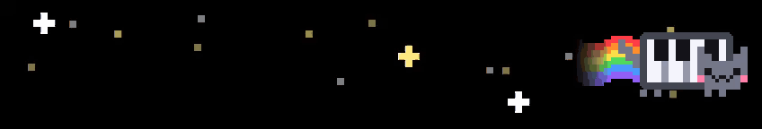
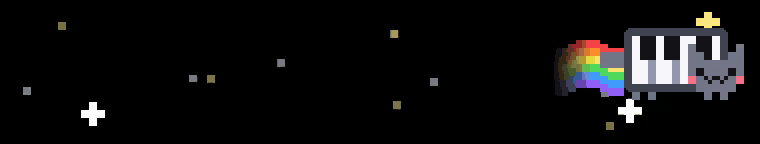
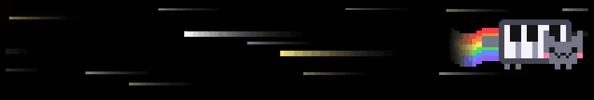
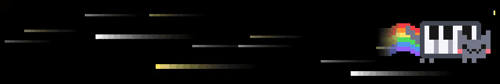
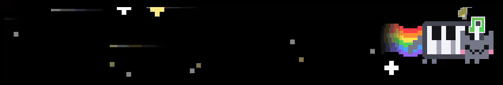
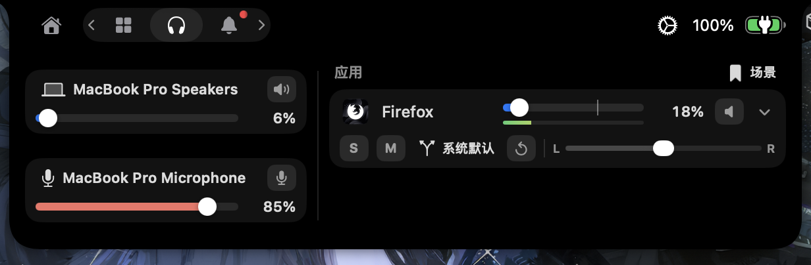

<h1 align="center">NekoNotch</h1>

<p align="center"><a href="README.md">简体中文</a> · English</p>

<p align="center">
  Read notifications, monitor system load, control app audio, and track Claude and Codex usage from your Mac's notch.<br>
  A rainbow cat changes speed with CPU load and adds floating notes while music plays.
</p>

<table>
  <tr>
    <td align="center"><br>Idle</td>
    <td align="center"><br>Half load</td>
  </tr>
  <tr>
    <td align="center"><br>Warp</td>
    <td align="center"><br>Full load</td>
  </tr>
  <tr>
    <td align="center" colspan="2"><br>Singing while music plays</td>
  </tr>
  <tr>
    <td align="center"><br>System monitor</td>
    <td align="center"><br>Mixer</td>
  </tr>
</table>

---

## About this project

The project began with [TheBoredTeam/boring.notch](https://github.com/TheBoredTeam/boring.notch) `v2.8-rc.2`. This page covers subsequent additions and improvements. Documentation for inherited features is preserved in [README.upstream.md](README.upstream.md).

- The default branch is `custom-main`. The project is independent of the upstream repository and does not push changes or submit PRs upstream; upstream fixes are cherry-picked when needed.
- In-app updates (Sparkle) are disabled to prevent official builds from overwriting the custom changes. The About page shows `Izumi Edition ✨ 1.1.0`. Rebuild after adopting upstream changes.
- Daily use and testing are mainly on macOS 27. The app keeps upstream's macOS 14+ requirement. The mixer's Core Audio process taps require macOS 14.2 or later.

## Added features

### Rainbow cat

While no media plays, a pixel cat with a piano keyboard for a body runs on the right of the closed notch. The left side shows a starry sky of the same width.

- Speed: the cat and the stars speed up with CPU load. Their top speeds at full load are set separately in settings; the defaults are 3× for the cat and 4× for the stars.
- Warp: when CPU load reaches the threshold (70% by default), the stars rush out of sight and streaks of light take their place. The stars return when the load falls more than 10 percentage points below the threshold. Warp can be turned off.
- Sky: stars come in two layers of depth, with near ones bigger, brighter and faster; a few of them twinkle. Stars drift in from the outer edge, pass behind the notch and come out on the other side. When the notch closes again, the sky appears already full.
- Media: the cat replaces the waveform beside the album art and sings as it runs. Colored notes rise from its head, more of them the louder the music.
- Notifications: the cat runs beside a notification's icon.
- Testing: the settings page has a full-width preview and test buttons that show the idle, half load, warp, full load and singing states in the preview and on the notch at the same time.
- Power: Core Animation and particle emitters play all the animation, and CPU load is read every 2 seconds. While idle, the app uses about 0.5% CPU.

### System monitor

Hovering over the cat or clicking it opens the system monitor instead of the usual tabs. You can turn this off in settings.

- Live load: the top half shows CPU, memory and network, each as a large figure with a line of the last 60 seconds. Clicking one shows its breakdown in place, without changing the panel's height.
- Device status: the bottom half shows storage, the battery (with health, cycle count and temperature) and the apps using the most energy.
- History: while the panel is closed, a reading is kept every 2 seconds; while it is open, every second. The panel opens with the last minute already drawn.
- Sources: the sandbox does not allow reading other processes, so the XPC helper reads the energy use. Network speed counts only Wi-Fi and Ethernet interfaces, so VPN traffic is not counted twice.

### Notification handling

Notifications can appear directly in the notch. You can also turn off an app's system banners and keep its notifications in the notch only.

- Banner capture: reads system notification banners through Accessibility, moves them off-screen, and displays them in the notch.
- Automatic expansion: opens the notch when a notification arrives, without needing to move the pointer over it. Display time is adjustable from 2 to 30 seconds, after which the notch closes automatically.
- App filtering: shows notifications from all apps or only the apps you select.
- Excluded apps: apps on this list are not shown in the notch, and their system banners are left alone. Apps that sent notifications recently are listed in settings so they can be added directly. macOS background agents (such as Background Items) share one name and icon.
- Icon only: for the chosen apps, a notification shows only the app's icon on the left of the closed notch, in place of the album art while music plays. A small dot on the icon marks it as a notification.
- Full-screen notifications: when full-screen mode hides the notch, notification text scrolls once beneath it alongside the source app's icon. Apps set to icon-only mode continue to show just their icon.
- Click to open: clicking a notification read from a banner presses the system banner itself, so the app opens the right conversation or item.
- Database reading: reads the Notification Center database directly and requires Full Disk Access. With this enabled, an app's notifications still appear in the notch when its system banners are disabled, avoiding a brief flash of the system banner.
- Source app preview: when an app with banners disabled sends a notification, its icon appears first. About 5 seconds later, the system writes the body to the database, and the text is filled in at the same position. The early signal comes from `usernoted` log entries indicating that the notification has been stored.
- Time-sensitive notifications: notifications marked as time-sensitive or critical in the database get a rotating rainbow border along the sides and bottom, and stay visible for twice as long. Ordinary notifications wait in the queue until they close. Classification uses the database record's `intrp` field. The passive level has been verified with real notifications; the time-sensitive and critical levels are inferred from the system's level definitions and have not yet been verified with real notifications.
- Service status: the top of the notification settings page shows the status of the background helper, banner capture, database reader, and early signal source, along with the time of the latest event. If notifications aren't appearing, check these statuses or click “Restart Service.”
- Test notifications: send a real system notification, or directly preview ordinary, time-sensitive, and full-screen scrolling notifications in the notch.

App icon lookup also covers `/System/Applications/Utilities`. The app-name-to-Bundle-ID index is now built in the background, avoiding a 1–2 second pause during lookup.

### Notification history and Focus

- Notifications tab: a new tab in the notch lists the last 50 notifications, newest first, with app, time, title, and body. Click one to open its app, hover to remove it, or clear everything from the left panel. A red dot on the tab icon marks notifications not yet seen.
- Privacy: the history is kept in memory only, never written to disk, and cleared when the app quits. Turning off “Keep a history” in the notification settings also hides the tab.
- Duplicate handling: a notification arriving through both the banner reader and the database is counted once. Separate database records are shown and retained even when their text is identical, including notifications from apps that hide message previews.
- Focus: while a Focus is on, the system shows no banners but still writes notifications to the database. The default, “Follow the Focus”, shows in the notch only what the system lets through: notifications that still get a banner, and time-sensitive ones. The rest go to the history with a moon mark. The alternatives are “Show all notifications” and “Show none”.
- The Focus state is read from `~/Library/DoNotDisturb/DB` and requires Full Disk Access. A Focus turned on by hand is detected; one that starts on a schedule is not.

### Dashboard

The dashboard uses a 12 × 4 grid. You can adjust each card's position and size in settings, such as 4×4 or 6×2. Layouts saved by older versions are converted once.

- Claude and Codex quotas: reads snapshots written by the collector scripts under `scripts/`; see [the collector guide](scripts/AI_USAGE.md) for installation. The Claude card remembers the selected App or CLI account. App quotas come from the desktop app's records; CLI quotas are written by the Claude Code status line after each turn. The collector attempts a fallback refresh when CLI data is missing or more than 30 minutes old. The card shows the sample time and labels stale data.
- AI Tokens: reads `~/Library/Application Support/RunCatIntegrations/ai-token-stats.json` and combines Claude and Codex token totals with a daily usage heat map. Recorded usage is retained after transcripts are deleted. Usage from Claude sessions deleted before the cache existed is estimated from Claude Code's statistics, with the estimated amount shown in the tooltip.
- Heat map: orange denotes Claude and violet denotes Codex. Days with both sources blend the colors in proportion to token usage; intensity represents the daily total. Dates use UTC, and the seven-day total includes today and the preceding six days.

Quota cards show each account's quota utilization; AI Tokens counts tokens. These are different measures. Token totals include cache usage and deduplicate repeated transcript records. Claude chats without local token details or recoverable statistics are excluded, so these totals do not represent complete account-wide usage across all devices.

The former storage, battery usage and system cards have moved to the system monitor.

All cards share the same card and gauge components. Content that does not fit a card's cells is clipped instead of covering the cards next to it.

### Mixer

The mixer provides per-app volume control similar to SoundSource, using Core Audio process taps.

- Adjust the volume of each app playing audio, with mute and solo controls.
- Adjust left/right balance or switch to mono.
- Choose an output device for each app.
- Control system output and microphone input, including device selection and the volume and mute controls supported by each device.
- Automatically retain per-app volume, mute, balance, mono, and output settings. Save the current settings as a named scene, restore a scene, or reset an individual app.
- If an assigned output disconnects, fall back to the system default while retaining volume and channel settings. Switch back automatically when the original device returns; the device button indicates the fallback state.
- Keep app rows in place while the page is open, so controls do not move when playback changes. Apply saved settings as soon as an app starts playing.
- View live level meters, calculated only while the page is visible. With the mixer enabled and the page hidden, CPU usage is about 0.2%–0.3% of a single core.

When no apps are playing audio, a single-line message appears in the center of the page. On first use, follow the prompt to grant the system audio recording permission.

### Clipboard area

The Shelf tab includes a text clipboard area containing the 20 most recent entries, limited to 2,000 characters each. Copying the same text moves it to the top. Entries can be copied again, removed individually, or cleared together.

History stays in memory and is cleared when the app quits or the clipboard area is disabled. Clipboard content marked as concealed, transient, or automatically generated is excluded, including recognized password-manager markers. Each entry occupies one line, with an ellipsis for overflow.

### Battery and charging alerts

- Low-battery alerts support multiple thresholds. The defaults are 20%, 10%, and 5%, selectable in settings. Alerts do not pop up repeatedly.
- Charging alerts use a centered, rounded panel. Disconnecting power triggers a single alert, and status text is available in Chinese.
- Battery line: an optional thin charge line under the closed notch, outside its outline so the hardware notch cannot hide it. While charging, a pulse sweeps along it from left to right; at 20% or less it glows red; a dark rim outside the line keeps it visible over light windows. Buttons in settings preview the low and charging looks.

### Music waveform

The new multicolor waveform option uses Core Animation for its looping animation, keeping CPU usage low. A slider controls the speed of the color changes; setting it to 0 keeps the colors still.

Audio levels are quantized to pixel steps before being published. FFT computation stops when no components are using the audio data.

## Fixes and improvements

- Notification handling on macOS 27: the system now places all banners in a full-screen window, which the previous height-based filter ignored. Detection now looks for banner elements and distinguishes live banners from entries in the Notification Center sidebar. Opening Notification Center no longer moves the wrong window or repeatedly displays notifications.
- Notification body updates: when two notifications arrived in succession, the second could replace the first icon placeholder, and the first notification's body would then be discarded as a duplicate. This is fixed.
- Gap below the notch: the macOS 27 menu bar is 1–2 pt taller than the notch. The notch height now follows the menu bar.
- OSD settings: added the missing page title so it no longer keeps the previous page's title.
- Calendar: the event list loads once when the notch opens. A skeleton view remains until the calendar data settles, and this waiting period is no longer cut short.
- Notification dismissal: fixed notifications staying open after automatic expansion because the pointer was incorrectly detected as hovering. The notification view also remains visible until the notch finishes closing.
- Helper startup: cleans up orphaned `log stream` processes left behind after a forced termination.
- Helper services: the helper's notification services restart after sleep, a dropped connection, or a stale banner watcher. The early signal ignores badge-only requests that carry no text.
- Closing the notch: the notch closes when the user dismisses a notification, even with the pointer over it. A notch opened by a file drag closes once the drag ends and the pointer is not on it.
- Energy: the charging pulse and the time-sensitive rainbow outline are played by Core Animation, so the main process stays nearly idle while they run. The mixer polls Core Audio only while its page is open or apps are re-routed; the notification database is read on file events with a slow fallback; the clipboard is checked once a second.
- Simplified Chinese: filled in most previously untranslated text. Custom features also have Chinese translations.

## Build and install

Requires macOS 15.6+ and Xcode 26+.

```bash
git clone https://github.com/1zumiii/NekoNotch.git
cd NekoNotch
git checkout custom-main
open boringNotch.xcodeproj
```

Open the project in Xcode and run it. To preserve Accessibility and Full Disk Access permissions across rebuilds, re-sign each build with a fixed code-signing requirement:

```bash
xcodebuild -project boringNotch.xcodeproj -scheme boringNotch -configuration Release \
  -derivedDataPath build CODE_SIGN_IDENTITY=- CODE_SIGNING_REQUIRED=NO build

codesign --force --sign - --preserve-metadata=entitlements,flags,runtime \
  -r='designated => identifier "theboringteam.boringnotch"' \
  "build/Build/Products/Release/Boring Notch.app"
```

**Sign only the outer app bundle. Do not add `--deep`.** It breaks the XPC helper's signature and causes notification handling to report missing Accessibility permission.

## Permissions

| Permission | Used for |
| --- | --- |
| Accessibility | Reading system notification banners and moving them off-screen |
| Full Disk Access | Reading the notification database for notifications with banners disabled, source app previews, and time-sensitive notification detection; reading the Focus state |
| System audio recording | Controlling per-app volume and reading audio levels |
| Calendar, Reminders, Camera, and others | Existing upstream features |

## Where the custom code lives

| Location | Contents |
| --- | --- |
| `boringNotch/managers/SystemNotificationManager.swift` | Notification display, queue, placeholders, and priorities |
| `boringNotch/managers/NotificationDatabaseWatcher.swift` | Notification database reader |
| `boringNotch/managers/NotificationHistory.swift`, `components/Notch/NotificationHistoryView.swift` | Notification history and the Notifications tab |
| `boringNotch/managers/FocusStatusMonitor.swift` | Focus state reader |
| `BoringNotchXPCHelper/NotificationWatcher.swift`, `EarlyNotificationSource.swift` | Banner capture and early signals, running in the XPC helper |
| `boringNotch/components/Dashboard/`, `components/Usage/` | Dashboard and usage cards |
| `boringNotch/components/Mixer/`, `managers/AudioCaptureManager.swift` | Mixer and audio capture |
| `boringNotch/models/BatteryAlertTracker.swift` | Battery alerts |
| `boringNotch/components/Notch/NotchShape.swift` | Battery line and charging pulse |
| `boringNotch/components/LiveActivities/RainbowCat/` | Rainbow cat, starry sky and system monitor |
| `boringNotch/CustomBuild.swift` | Disabling updates and setting the custom version |

## Credits and license

Thanks to [Boring Notch](https://github.com/TheBoredTeam/boring.notch) and its contributors, and to the authors of dependencies including [MediaRemoteAdapter](https://github.com/ungive/mediaremote-adapter) and [NotchDrop](https://github.com/Lakr233/NotchDrop). The icon is by [@maxtron95](https://github.com/maxtron95).

This project keeps the upstream license (GPL-3.0). See [LICENSE](LICENSE) and [THIRD_PARTY_LICENSES](THIRD_PARTY_LICENSES).
