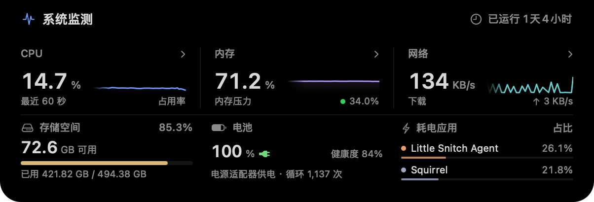
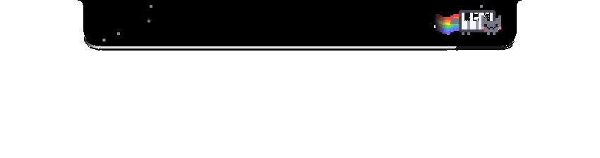
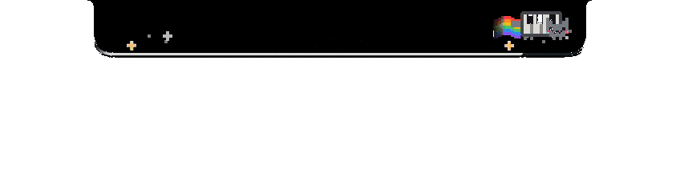
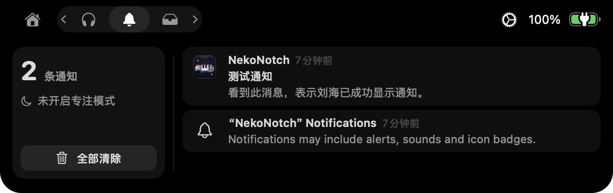
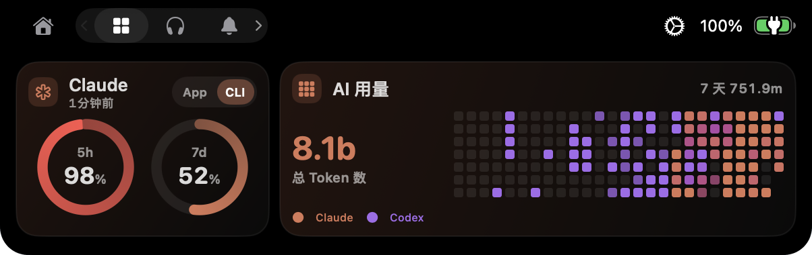
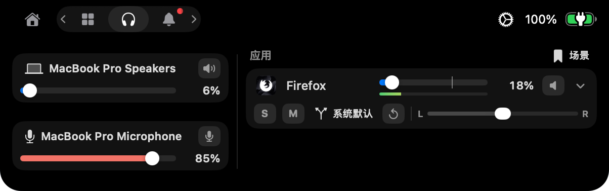

<h1 align="center">NekoNotch</h1>

<p align="center"></p>

<p align="center"><a href="README.md">简体中文</a> · English</p>

<p align="center">
  Read notifications, monitor system load, control app audio, and track Claude and Codex usage from your Mac's notch.<br>
  A piano cat changes speed with CPU load and adds floating notes while music plays.
</p>

<p align="center"></p>

---

NekoNotch started from [Boring Notch](https://github.com/TheBoredTeam/boring.notch) `v2.8-rc.2` and is now an independent project. Features inherited from upstream, such as music playback, the calendar and the file shelf, are described in [README.upstream.md](README.upstream.md).

## Download and install

Requires macOS 14 or later.

### First installation

1. Download the latest `NekoNotch-<version>.zip` from [Releases](https://github.com/1zumiii/NekoNotch/releases), unzip it, and move `NekoNotch.app` to Applications.
2. The app is not notarized by Apple. Open it the first time by right-clicking it in Finder and choosing Open, or run:

   ```bash
   xattr -dr com.apple.quarantine /Applications/NekoNotch.app
   ```

3. Grant the required permissions listed under [Permissions](#permissions).

### Updates and permissions

When a new version is out, the About page and the menu bar menu link to it. The app never downloads or installs updates itself.

To update, replace the old version in Applications. Starting with 1.1.1, releases use a fixed signing certificate. macOS identifies the app by its bundle ID and certificate, preserving permissions across updates.

Accessibility, Full Disk Access and other permissions must be granted again when updating from 1.1.0 or switching between a local build and a release. Version 1.1.0 used ad-hoc signing, which ties permissions to the code hash. Local builds and releases use different certificates. To grant permissions again, remove NekoNotch from the relevant permission lists in System Settings, then add it back.

## Features

### Piano cat

While no media plays, a pixel cat with a piano keyboard for a body runs on the right of the closed notch, with a starry sky of the same width on the left.

<div align="center">
<table>
  <tr>
    <td align="center"><br>Speeding up</td>
    <td align="center"><br>Into warp</td>
  </tr>
  <tr>
    <td align="center"><br>Out of warp (hard stop)</td>
    <td align="center"><br>Playing media</td>
  </tr>
</table>
</div>

The cat and stars speed up as CPU load rises. At the warp threshold (70% by default), a red exclamation mark flashes three times, the cat passes through a blue ring, and the stars turn into light streaks. When load falls 10 percentage points below the threshold, the cat sits back and stops hard. The stars slide to a stop in three steps, and the cat resumes running after about a second. Warp can be turned off in the settings.

The sky has three depth layers, with closer stars appearing larger, brighter and faster. Stars vary in brightness and color, including white, pale yellow and pale blue. They pass behind the notch and exit on the other side, accompanied by twinkling and occasional shooting stars.

- Speed and warp: each speed limit can be set separately, with defaults of 3× idle speed for the cat and 5.5× for the stars. With warp enabled, both reach their top speeds at the warp threshold. With warp disabled, they reach them at full load.
- Media: the cat can replace the waveform beside the album art and emit colored notes in alternating forward and backward directions. Intervals, angles and sway vary randomly, and notes traveling in the same direction do not overlap. Enabling "Notes follow the volume" produces more notes as volume rises. This requires the realtime audio waveform.
- Notifications: the cat runs beside a notification's icon.
- Preview: the settings page has a full-width preview and test buttons that show the idle, speed-up, warp, full load and singing states in the preview and on the notch at the same time. Each test lasts 15 seconds.
- Menu avoidance: when the left starry wing covers app menus, moving the pointer over it collapses the wing to reveal them. The wing expands again after the pointer leaves the menu bar and all menus are closed.

<p align="center"><br>Menu avoidance</p>

Core Animation and particle emitters handle animation playback. Paths are calculated when notes and shooting stars appear, and CPU load is read every 2 seconds. At idle, the app uses about 0.5% CPU.

### System monitor

Hovering over the cat or clicking it opens the system monitor. This can be turned off in settings.

<p align="center"></p>

- Live load: the top half shows CPU, memory and network as large figures, each with the last 60 seconds drawn as a line. Clicking one shows its breakdown in place.
- Device status: the bottom half shows storage, the battery (health, cycle count and temperature) and the apps using the most energy.
- History: a reading is taken every 2 seconds while the panel is closed and every second while it is open, so the panel opens with the last minute already drawn.
- Network speed counts only Wi-Fi and Ethernet interfaces, so VPN traffic is not counted twice. Energy use is read by the XPC helper.

### Notifications

Notifications can appear right in the notch. An app's system banners can be turned off while its notifications still show in the notch.

<p align="center"></p>

- Banner takeover: system notification banners are read through Accessibility, moved off-screen and shown in the notch instead. The notch opens on its own and closes after 2 to 30 seconds.
- Database reading: when turned on, the Notification Center database is read directly (this needs Full Disk Access). Notifications from apps whose banners are off still appear, and system banners no longer flash briefly. The source app's icon appears first, and the text follows once the system writes it to the database.
- Time-sensitive notifications: notifications marked time-sensitive or critical get a rotating rainbow outline and stay twice as long, while the others wait in a queue.
- App rules: show notifications only from selected apps, or exclude some. An app can also be set to icon only, which shows just its icon on the left of the closed notch.
- Full screen: while a full-screen app hides the notch, a notification with text scrolls once in a single line below it.
- Click-through: clicking a notification captured from a banner clicks the system banner, so the app opens the matching conversation or item.
- Notifications tab: lists the last 50 notifications, newest first. Open the app, remove one, or clear them all. A red dot on the tab icon marks notifications not yet seen.
- Focus: by default, the notch shows only notifications allowed by the current Focus. Other notifications are saved to history with a moon icon. Settings also allow showing all notifications or hiding them all. Scheduled Focus activation is not detected.
- Service status: the notification settings show whether the helper, the banner reader and the database reader are running, with a "Restart services" button and test notifications.

<div align="center">
<table>
  <tr>
    <td align="center"><br>Time-sensitive notification</td>
    <td align="center"><br>Scrolling line in full screen</td>
  </tr>
</table>
</div>

<p align="center"><br>Notifications tab</p>

### Dashboard and AI usage

The dashboard uses a 12 × 4 grid. Each card's position and size can be changed in settings, such as 4 × 4 or 6 × 2.

<p align="center"></p>

- Claude and Codex quotas: show the proportion of each account's quota used. The Claude card can switch between App and CLI accounts and indicates the sample time and stale data. Data comes from the collector scripts in `scripts/`. See [the collector guide](scripts/AI_USAGE.md) for installation instructions.
- AI usage: totals Claude and Codex tokens and displays daily usage as a heat map. Claude is orange and Codex is purple. Days with both blend the colors in proportion to usage, with intensity indicating the total. Dates use UTC.
- Token totals include cache tokens and skip duplicate transcript records. Usage already counted is kept after transcripts are deleted. The totals cover only the sessions this Mac can read, not an account's usage on every device.

### Mixer

Per-app volume control built on Core Audio process taps (macOS 14.2 or later).

<p align="center"></p>

- Set the volume of each app playing audio, with mute, solo, left/right balance and mono.
- Route each app to a separate output device. If the device disconnects, audio falls back to the system default and switches back when the device reconnects.
- Control system output and microphone input, including device, volume and mute.
- Per-app settings are remembered and can be saved as named scenes to restore later.
- Live level meters are calculated only while the page is visible. With the page hidden, the mixer uses about 0.2%–0.3% of one core.

### More

- Clipboard: the Shelf keeps the last 20 text clipboard entries to copy again or remove. Entries stay in memory only, and content marked as concealed, such as from password managers, is skipped.
- Battery: low-battery alerts at several thresholds (20%, 10% and 5% by default). An optional charge line under the closed notch shows a sweep of light while charging and glows red when the battery is low.
- Multicolor waveform: the music waveform can be a looping color animation played by Core Animation, with adjustable speed.
- Simplified Chinese: the interface is translated into Simplified Chinese, including all new features.

<div align="center">
<table>
  <tr>
    <td align="center"><br>The charge line while charging</td>
    <td align="center"><br>The red glow on a low battery</td>
  </tr>
</table>
</div>

<p align="center"><br>Multicolor waveform</p>

## Build from source

Requires macOS 15.6 or later and Xcode 26 or later.

```bash
git clone https://github.com/1zumiii/NekoNotch.git
cd NekoNotch
open boringNotch.xcodeproj
```

Open the project in Xcode and run it. By default the build is signed ad hoc, so macOS records permissions against the code hash and asks for Accessibility, Full Disk Access and the others again after every rebuild.

To keep permissions across rebuilds, sign with a fixed certificate. Create a code signing certificate in Keychain Access (self-signed is enough), then create `Configuration/LocalSigning.xcconfig` with its name or SHA-1. The file is listed in `.gitignore` and is never committed:

```
CODE_SIGN_IDENTITY = <certificate name or SHA-1>
CODE_SIGN_IDENTITY[sdk=macosx*] = <certificate name or SHA-1>
CODE_SIGN_STYLE = Manual
DEVELOPMENT_TEAM =
```

Then build with it:

```bash
xcodebuild -project boringNotch.xcodeproj -scheme boringNotch -configuration Release \
  -xcconfig Configuration/LocalSigning.xcconfig build
```

The app and its XPC helper use the same certificate. macOS identifies them by bundle ID and certificate, preserving permissions across rebuilds.

## Permissions

| Permission | Used for |
| --- | --- |
| Accessibility | Reading system notification banners and moving them off-screen |
| Full Disk Access | Reading the notification database and the Focus state |
| System audio recording | Controlling per-app volume and reading audio levels |
| Calendar, Reminders, Camera, and others | Features inherited from upstream |

## Privacy

- The notification history and the clipboard entries are kept in memory only and cleared when the app quits.
- Quotas and AI usage are read from files generated by local collector scripts. No data is uploaded.
- The update check asks the GitHub API (`api.github.com`) for this repository's latest release, at most once a day by default. It can be turned off on the About page.

## Contributing

Issues and pull requests are welcome. See [CHANGELOG.md](CHANGELOG.md) for the changes in each version.

## Credits and license

Thanks to [Boring Notch](https://github.com/TheBoredTeam/boring.notch) and its contributors, and to the authors of dependencies including [MediaRemoteAdapter](https://github.com/ungive/mediaremote-adapter) and [NotchDrop](https://github.com/Lakr233/NotchDrop). The icon is by [@maxtron95](https://github.com/maxtron95).

This project keeps the upstream license, GPL-3.0. See [LICENSE](LICENSE) and [THIRD_PARTY_LICENSES](THIRD_PARTY_LICENSES).
