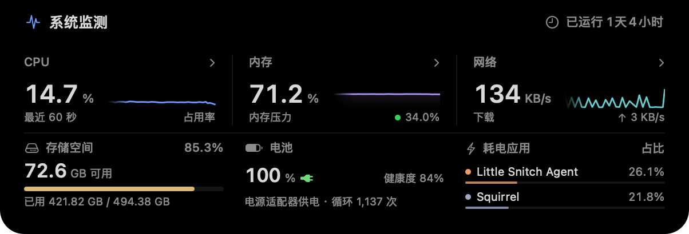
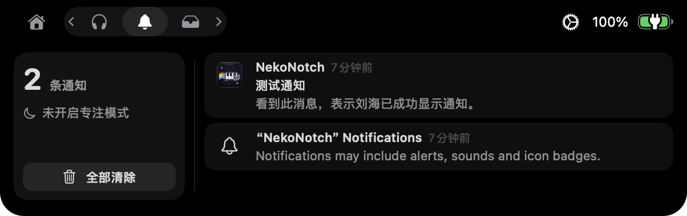
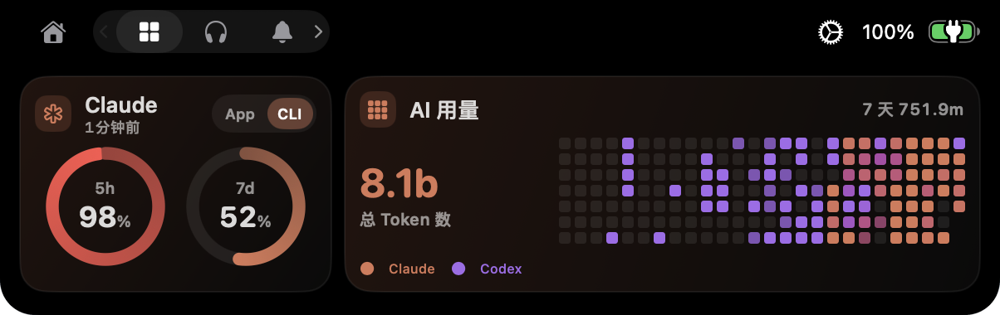
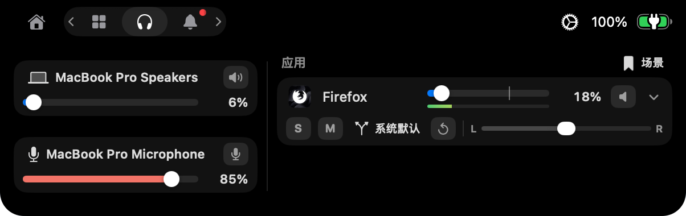

<h1 align="center">NekoNotch</h1>

<p align="center"></p>

<p align="center">简体中文 · <a href="README.en.md">English</a></p>

<p align="center">
  在 Mac 刘海中查看通知、监测系统负载、调节应用音量，并汇总 Claude 与 Codex 的用量。<br>
  彩虹猫随 CPU 负载改变速度，播放音乐时伴随音符动画。
</p>

<p align="center"></p>

---

NekoNotch 基于 [Boring Notch](https://github.com/TheBoredTeam/boring.notch) `v2.8-rc.2` 开发，现为独立项目。音乐播放、日历、文件暂存区等继承自上游的功能，说明见 [README.upstream.md](README.upstream.md)。

## 功能

### 彩虹猫

未播放媒体时，键盘造型的像素猫在收起的刘海右侧奔跑，左侧显示等宽的星空。

<div align="center">
<table>
  <tr>
    <td align="center"><br>空闲</td>
    <td align="center"><br>CPU 中等负载（加速）</td>
  </tr>
  <tr>
    <td align="center"><br>CPU 高负载（跃迁）</td>
    <td align="center"><br>播放媒体</td>
  </tr>
</table>
</div>

- 速度：CPU 占用率越高，猫和星空移动得越快。满载时相对于空闲的速度倍数可分别设置，默认猫为 3 倍、星空为 4 倍。
- 跃迁：CPU 占用率达到阈值（默认 70%）时，星星快速移出画面，变为光线；占用率回落到阈值以下 10 个百分点后，恢复为星星。此效果可以关闭。
- 星空：星星分为远近两层，近处的更大、更亮、移动更快，部分星星会闪烁。星星从外侧移入，经过刘海后方，再从另一侧移出。
- 播放媒体：猫可替代专辑封面旁的音频波形，奔跑时头部飘出彩色音符，音量越大，音符越多。
- 通知：有通知时，猫在通知图标旁奔跑。
- 预览：设置页提供全宽预览和测试按钮，可在预览和刘海中同时查看空闲、加速、跃迁、满载和唱歌状态。每次测试持续 15 秒。
- 功耗：动画由 Core Animation 和粒子发射器播放，CPU 占用率每 2 秒读取一次。空闲时，App 的 CPU 占用率约为 0.5%。
- 菜单避让：应用的菜单项较多、最后几个菜单被左侧星空翼盖住时，指针移到星空翼上，星空翼即收起，露出下面的菜单；指针离开菜单栏且没有菜单展开后，星空翼重新展开。

<p align="center"><br>菜单避让</p>

### 系统监测

指针悬停在彩虹猫上或点击彩虹猫时，展开系统监测面板。此入口可在设置中关闭。

<p align="center"></p>

- 实时负载：上半部分以大号数字显示 CPU、内存和网络，并绘制最近 60 秒的趋势。点击某一项，在原位置查看明细。
- 设备状态：下半部分显示存储空间、电池（健康度、循环次数和温度）和耗电最多的应用。
- 历史数据：面板收起时每 2 秒采样一次，展开后改为每秒一次，因此展开时已有最近一分钟的趋势。
- 网速只统计 Wi-Fi 和以太网接口，避免重复计算 VPN 流量。耗电应用由 XPC 助手读取。

### 通知

通知可以直接显示在刘海中。关闭某个应用的系统横幅后，它的通知仍可只在刘海中出现。

<p align="center"></p>

- 横幅接管：通过辅助功能读取系统通知横幅，将横幅移到屏幕外，再在刘海中显示。收到通知时刘海自动展开，停留 2～30 秒后收起。
- 数据库读取：开启后直接读取通知中心数据库（需要完全磁盘访问权限）。关闭了横幅的应用，其通知也能显示，系统横幅也不会短暂闪现。正文写入数据库之前，刘海先显示来源应用的图标，正文到达后再补上文字。
- 时间敏感通知：标记为“时间敏感”或“紧急”的通知带有旋转的彩虹描边，停留时间加倍，其余通知排队等候。
- 应用规则：可只显示选中应用的通知，或排除某些应用。也可将应用设为“仅显示图标”，此时只在收起的刘海左侧显示其图标。
- 全屏：全屏隐藏刘海时，带正文的通知在刘海下方单行滚动一次。
- 点击跳转：点击来自横幅的通知时，触发系统横幅的点击操作，由应用打开对应的会话或位置。
- 通知标签页：按时间倒序列出最近 50 条通知，可打开对应应用、删除单条或全部清除。有未查看的通知时，标签页图标显示红点。
- 专注模式：默认只在刘海中显示专注模式允许提醒的通知，其余通知仅记入历史，并带有月亮标记。也可改为全部显示或全部不显示。按计划自动开启的专注模式无法识别。
- 服务状态：通知设置页列出后台助手、横幅读取和数据库读取的运行状态，并提供“重启服务”和测试通知。

<div align="center">
<table>
  <tr>
    <td align="center"><br>时间敏感通知</td>
    <td align="center"><br>全屏时的滚动通知</td>
  </tr>
</table>
</div>

<p align="center"><br>通知标签页</p>

### 仪表盘与 AI 用量

仪表盘采用 12 × 4 的网格，卡片的位置和尺寸可在设置中调整，例如 4 × 4 或 6 × 2。

<p align="center"></p>

- Claude 和 Codex 额度：显示各账户的额度使用比例。Claude 卡片可在 App 与 CLI 两个账户之间切换，并标注采样时间和过期数据。数据来自 `scripts/` 下的采集脚本，安装方法见 [采集脚本说明](scripts/AI_USAGE.md)。
- AI 用量：汇总 Claude 和 Codex 的累计 Token 数，并以热力图显示每日用量。Claude 为橙色，Codex 为紫色，同一天两者都有时按占比混色，深浅表示总量。日期按 UTC 划分。
- 用量统计包含缓存 Token，并对重复的会话记录去重。会话记录删除后，已统计的用量仍会保留。统计只覆盖本机能读到的会话，不代表账户在所有设备上的总用量。

### 混音器

基于 Core Audio 进程 tap 的应用音量控制（需要 macOS 14.2 及以上）。

<p align="center"></p>

- 单独调整每个正在播放音频的应用的音量，支持静音、独奏、左右声道平衡和单声道。
- 为每个应用指定输出设备；设备断开时改用系统默认设备，重新连接后自动切回。
- 控制系统输出和麦克风输入，包括设备选择、音量和静音。
- 自动记住每个应用的设置，可保存为命名场景，之后一键恢复。
- 显示实时电平，只在页面可见时计算。页面不可见时，CPU 占用约为单核的 0.2%～0.3%。

### 其他

- 剪贴板：暂存区（Shelf）中保留最近 20 条文本剪贴板记录，可重新复制或删除。记录只保存在内存中，密码管理器等标记为保密的内容不会记录。
- 电池：低电量提醒支持多个阈值（默认 20%、10%、5%）。可在收起的刘海下方显示一条电量线，充电时有光沿线扫过，低电量时显示红色光晕。
- 炫彩波形：音乐波形可改为由 Core Animation 播放的彩色循环动画，颜色变化速度可调。
- 简体中文：界面提供简体中文翻译，新增功能均已翻译。

<div align="center">
<table>
  <tr>
    <td align="center"><br>充电时的电量线</td>
    <td align="center"><br>低电量时的红色光晕</td>
  </tr>
</table>
</div>

<p align="center"><br>炫彩波形</p>

## 下载与安装

系统要求：macOS 14 及以上。

1. 从 [Releases](https://github.com/1zumiii/NekoNotch/releases) 下载最新的 `NekoNotch-<版本>.zip`，解压后将 `NekoNotch.app` 移到“应用程序”文件夹。
2. App 未经 Apple 公证。首次打开时，在 Finder 中右键点击 App 并选择“打开”，或在终端执行：

   ```bash
   xattr -dr com.apple.quarantine /Applications/NekoNotch.app
   ```

3. 按提示授予所需权限，见下文“权限”一节。

有新版本时，“关于”页和菜单栏菜单会给出下载链接。App 不会自行下载或安装更新。

升级时，用新版本替换“应用程序”文件夹中的旧版本。从 1.1.1 起，发布版使用固定的证书签名，系统按 Bundle ID 和证书识别 App，升级后已授予的权限保持有效。

以下情况需要重新授予辅助功能、完全磁盘访问等权限：从 1.1.0 升级时（1.1.0 使用 ad-hoc 签名，权限按代码哈希记录），以及在自行编译的版本和发布版之间互相替换时（两者使用不同的证书）。做法是在“系统设置”的对应列表中先移除原有的 NekoNotch，再重新添加。

## 从源码编译

需要 macOS 15.6 及以上和 Xcode 26 及以上。

```bash
git clone https://github.com/1zumiii/NekoNotch.git
cd NekoNotch
open boringNotch.xcodeproj
```

在 Xcode 中打开项目后即可运行。默认使用 ad-hoc 签名，系统按代码哈希记录授权，因此每次重新编译后，都要重新授予辅助功能、完全磁盘访问等权限。

如需在重新编译后保留授权，可改用固定的证书签名。先在“钥匙串访问”中创建一个代码签名证书（自签名即可），再新建 `Configuration/LocalSigning.xcconfig`，填入证书名称或 SHA-1。此文件已加入 `.gitignore`，不会被提交：

```
CODE_SIGN_IDENTITY = <证书名称或 SHA-1>
CODE_SIGN_IDENTITY[sdk=macosx*] = <证书名称或 SHA-1>
CODE_SIGN_STYLE = Manual
DEVELOPMENT_TEAM =
```

然后带上这个配置编译：

```bash
xcodebuild -project boringNotch.xcodeproj -scheme boringNotch -configuration Release \
  -xcconfig Configuration/LocalSigning.xcconfig build
```

App 和 XPC 助手都用这张证书签名，系统改为按 Bundle ID 和证书识别，重新编译后授权保持有效。

## 权限

| 权限 | 用途 |
| --- | --- |
| 辅助功能 | 读取系统通知横幅，并将横幅移到屏幕外 |
| 完全磁盘访问 | 读取通知数据库和专注模式状态 |
| 系统音频录制 | 控制各应用的音量，读取音频电平 |
| 日历、提醒事项、相机等 | 继承自上游的功能 |

## 隐私

- 通知历史和剪贴板记录只保存在内存中，退出 App 后清空。
- 额度和 AI 用量读取本机采集脚本生成的文件，不上传任何数据。
- 检查更新时，App 访问 GitHub API（`api.github.com`）查询本仓库的最新版本，默认每天最多一次，可在“关于”页关闭。

## 参与开发

欢迎提交 issue 和 PR，各版本的改动见 [CHANGELOG.md](CHANGELOG.md)。

## 致谢与许可

感谢上游项目 [Boring Notch](https://github.com/TheBoredTeam/boring.notch) 及其贡献者，以及 [MediaRemoteAdapter](https://github.com/ungive/mediaremote-adapter)、[NotchDrop](https://github.com/Lakr233/NotchDrop) 等依赖的作者。图标由 [@maxtron95](https://github.com/maxtron95) 制作。

本项目沿用上游许可证 GPL-3.0，见 [LICENSE](LICENSE) 和 [THIRD_PARTY_LICENSES](THIRD_PARTY_LICENSES)。
